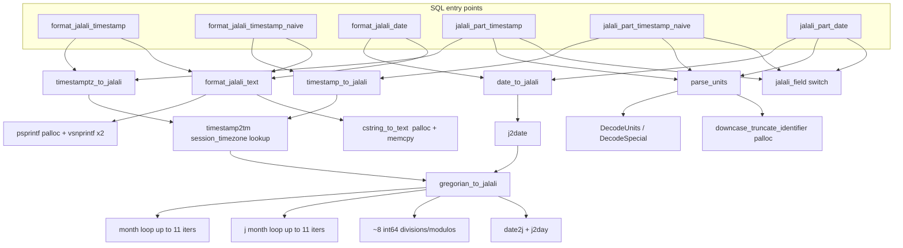

# jalali_utils performance review

The per-step table and the parallel result are measured. The gains in the suggestions table are estimates from those numbers, not measured.

Measured on PG 18 / arm64 (Docker), 2,000,000 rows, `jit=off`, no parallelism, single run each
(treat differences under ~10% as noise). Per-row cost = (query time - 65 ms scan baseline) / 2M.

## Call graph

## Measured per-row cost

| Step | ms / 2M rows | ≈ ns / row |
|---|---|---|
| seq scan + `sum(d - date)` baseline (also == empty C function) | 65 | – |
| `parse_units` (text → DTK field) | +36 | 18 |
| `j2date` alone | +16 | 8 |
| date → Jalali (`j2date` + `gregorian_to_jalali`, no parse) | +90 | 45 |
| timestamptz → Jalali (`timestamp2tm` + algorithm) | +130 | 65 |
| `format_jalali_text` alone (psprintf + cstring_to_text) | +180 | 90 |
| **`jalali_part(text, date)` total** | +145 | 72 |
| `format_jalali(date)` total | ~315 | 155 |
| `format_jalali(timestamp)` total | ~425 | 210 |
| `extract(year from date)` for reference | ~90 | 45 |

`jalali_part` is about 1.6x `extract`, which is already cheap. Nothing here is slow in absolute terms;
the real wins are at the query level (index / parallel), not micro-optimizing C.

## Suggestions, ranked by benefit

| # | Where | Suggestion | Expected gain | Cost / risk |
|---|---|---|---|---|
| 1 | Query level (done) | IMMUTABLE/PARALLEL SAFE markings enable parallel plans. Verified: `jalali_part('day', d)` over 2M rows dropped 215 ms to 89 ms with 2 workers. | ~2.4x | none, shipped in 0.0.3 |
| 2 | Application / SQL | Index on `jalali_part('year'|'month', date_col)` for date columns, or on `timestamp` columns after the tz conversion. A `timestamptz` column can't be indexed (STABLE). Prefer range predicates on the raw column (`date_order >= X AND date_order < Y`) over `jalali_part(...) = n` in WHERE; ORMs and query builders usually do this. | index scan vs full scan | needs per-column DDL; only worth it for big tables |
| 3 | Application layer | Not measured. A group-by that needs several parts (e.g. year and month) evaluates the full conversion once per part per row. Low value, so no change suggested. | small | low value |
| 4 | C: `parse_units` | Skip `downcase_truncate_identifier` (palloc) and `DecodeUnits`: fast-path with a length switch and `pg_strncasecmp` against the 12 supported names (`year`, `month`, `day`, ...). | -15 ns/row of 72 (~20%) | needs to keep today's accepted aliases (`dow`, `doy`, `isodow`, `quarter`, `decade`, `century`, plus any other spellings `DecodeUnits` accepts today; list them with a quick scan before replacing it). Verify against the test suite |
| 5 | C: `parse_units` | Constant folding: the unit argument is nearly always a literal. Add a planner support function (`prosupport`) or cache the parsed unit in `fcinfo->flinfo->fn_extra` keyed on the text, so parsing happens once per query instead of per row. | removes the 18 ns entirely for repeated units (~25%) | a few lines; `fn_extra` + memcmp of unit text is safe and simple |
| 6 | C: `gregorian_to_jalali` | Avoid the two month loops and ~8 64-bit divisions: derive the Jalali date straight from the Julian day number (`date + POSTGRES_EPOCH_JDATE`) with one 12053-day cycle division, and compute the Gregorian day count with a precomputed cumulative month table instead of a loop. For `date` input it can skip `j2date`, whose own cost is ~8 ns. | -15 to -25 ns/row | the algorithm is validated against 540k days; rewriting needs the same exhaustive check |
| 7 | C: `jalali_field` | Compute only the requested field. For `year`, `month`, `day`, `quarter` there's no need for `doy`, `dow`, `isodow` (the `date2j` + `j2day` pair runs on every call). | -5 to -10 ns/row | make `dow`/`isodow` lazy; trivial |
| 8 | C: `format_jalali_text` | Replace `psprintf` + `cstring_to_text` (two palloc + two copies, `vsnprintf` parsing) with a direct `palloc(VARHDRSZ + 19)` and hand-written digit emission, then `SET_VARSIZE`. This is the dominant cost of `format_jalali`. | `format_jalali` roughly 2x faster (90 ns → ~25 ns) | small, deterministic; keep the regression expected output |
| 9 | C: `timestamptz_to_jalali` | `timestamp2tm` with `session_timezone` does a tz-database lookup per row (about 20 ns more than the naive path). Cache the last UTC offset window (`pg_next_dst_boundary`) or, for the common whole-column case, convert to a naive `timestamp` in the application first. | ~20 ns/row on tz columns | only worth it if timestamptz is used directly |
| 10 | Server config | `jalali_utils` in `shared_preload_libraries` only saves the one-time dlopen at first call per backend (~ms). It has no per-row effect. Keep it if you want it image-wide as the other extensions. | negligible | none |
| 11 | JIT | JIT is on by default in PG. For these short C functions it only adds compile time; many small queries are better off with `jit = off` (check `jit_above_cost`). | removes ~10–50 ms startup on mid-size queries | server setting, not extension |
| 12 | Build | Dockerfile builds with PGXS default `-O2`. No `-march` flags, which is correct for a multi-arch image. | – | – |

## What is *not* a problem
- No per-row memory leak: allocations (`downcase_truncate_identifier`, `psprintf`) live in the per-tuple context and are freed by PostgreSQL.
- No global state, locks, or syscalls in the hot path.
- Output size: `format_jalali` result is at most 19 bytes, so no TOAST/detoast concerns; `PG_GETARG_TEXT_PP` avoids copying the unit argument.

## Suggested order
1. #5 (cache parsed unit), #7 (lazy dow), #8 (format without psprintf): ~1 hour, low risk, about 30% on `jalali_part` and 2x on `format_jalali`.
2. #6 only if profiling on production queries shows `jalali_part` matters after #1 and #2.

## Implemented (0.0.3 build) and measured

Same 2M-row table, PG 18, `jit=off`, no parallelism, session TimeZone `Asia/Tehran`, best of 2 runs (ms).

| Query | before | after | change |
|---|---|---|---|
| `jalali_part('year', date)` | 212 | 168 | -21% |
| `jalali_part('dow', date)` | 242 | 167 | -31% |
| `jalali_part('day', timestamp)` | 225 | 175 | -22% |
| `jalali_part('day', timestamptz)` | 283 | 220 | -22% |
| `format_jalali(date)` | 343 | 223 | -35% |
| `format_jalali(timestamp)` | 494 | 282 | -43% |
| `format_jalali(timestamptz)` | 559 | 337 | -40% |

What was done:
- #1 parallel/immutability markings (0.0.3 upgrade script, earlier).
- #3 parsed unit cached in `fn_extra`, keyed on the raw text (units over 32 bytes are re-parsed each call).
- #4 weekday computed from the day count, cumulative month table; no `date2j`/`j2day`, no month loop for the Gregorian side.
- #5 `format_jalali` writes digits straight into the result text (no `psprintf`/`cstring_to_text`).
- #7 UTC-offset window cache for the session time zone via `pg_next_dst_boundary` (invalidated when the zone object or the instant leaves the window).

Equivalence check against the previous build (same inputs, md5 over all outputs): identical for 200k random dates, 200k random timestamps, 200k random timestamptz in 11 zones (including Lord_Howe, Kathmandu, Apia, Casablanca), every 30 minutes +/- 1 microsecond across 2020-2023 DST transitions, mid-query `TimeZone` changes, repeated zone switches between statements, and the edge values (year 1, 622-03-20/21, +/-infinity, max timestamp, out of range).

Not done: #6 (rewriting `gregorian_to_jalali`), which still needs profiling to justify.
